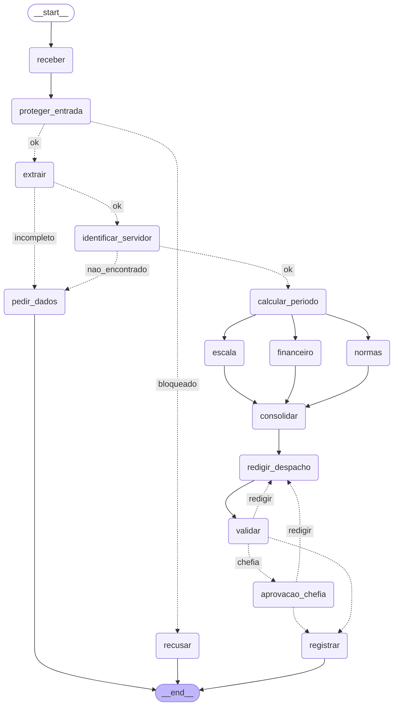

# Entrega: Assistente de Gestão de Pessoas

**Aluno(s):** RAFAEL HENRIQUE S. N. ROCHA
**Até onde chegou:** [x] Marco mínimo (Etapa 6)  [x] Marco completo (Etapa 9)  [x] Etapas 10–11
**Opcionais e bônus feitos:** [x] 🆕 A  [x] 🆕 B  [x] 🆕 C  ( ) Outro: ______

## Etapa 0: quem verifica cada regra?

| Regra | Tema | Quem verifica (função Python / agente / humano) | Por quê | Onde foi implementada (preencha na Etapa 11) |
|---|---|---|---|---|
| N1 | férias | função Python | conta: dias corridos >= 5 e <= saldo | etapa04_ferramentas.py (calcular_periodo_ferias) e dados_rh.py |
| N2 | férias | função Python | conta: dias + vendidos <= saldo, vendidos <= 10 | etapa04_ferramentas.py (calcular_periodo_ferias) |
| N3 | férias | função Python | consulta de calendário (feriados e fim de semana) | etapa04_ferramentas.py (calcular_periodo_ferias / BrasilAPI) |
| N4 | prazos | função Python | diferença entre datas (dias corridos ou úteis) | etapa04_ferramentas.py (calcular_periodo_ferias) |
| N5 | escala | função Python | contagem de afastados da equipe no período x limite de 30% | etapa05_mcp_rh.py (conflito_escala) e etapa04_ferramentas.py |
| N6 | abono | função Python | dia útil e saldo de abonos | etapa04_ferramentas.py (calcular_periodo_abono) |
| N7 | diária | função Python | conta (diárias + meia diária, câmbio); o agente Financeiro só explica | etapa04_ferramentas.py (calcular_valor_diarias) e etapa06_agentes.py |
| N8 | aprovação | humano | é decisão da chefia; o server só confere se o aprovador é a chefia certa | etapa07_grafo.py (aprovacao_chefia) e etapa05_mcp_rh.py (registrar_decisao) |
| N9 | saúde | função Python (guardrail) | regex de CID/CPF barra antes de qualquer agente ver o texto; o classificador (agente) cobre o que a regex não pega | etapa03_guardrails.py (encontrar_dado_sensivel / nota_escopo) |
| N10 | dados | função Python (guardrail de saída) | regex no despacho antes de gravar | etapa07_grafo.py (registrar / encontrar_dado_sensivel) |

## Etapa 11: os 12 casos

Compare **caminho e estado**, não o texto do despacho.

| Caso | Caminho percorrido | Resultado (bloqueado / pediu dados / triagem humana / indeferido / pausou na chefia / registrado + protocolo) | Bateu com o esperado? |
|---|---|---|---|
| C1_abono_simples | receber -> proteger_entrada -> extrair -> identificar_servidor -> calcular_periodo -> normas\|escala\|financeiro -> consolidar -> redigir_despacho -> validar -> registrar | registrado (deferido, sem chefia, protocolo ae788d33) | Sim |
| C2_ferias_com_venda | receber -> proteger_entrada -> extrair -> identificar_servidor -> calcular_periodo -> normas\|escala\|financeiro -> consolidar -> redigir_despacho -> validar -> aprovacao_chefia -> registrar | pausou na chefia; após 'sim' da 1010: registrado (deferido, protocolo b7b6f485) | Sim |
| C3_dado_de_saude | receber -> proteger_entrada -> recusar | bloqueado (dado sensível: CPF/CID na entrada) | Sim |
| C4_fora_do_escopo | receber -> proteger_entrada -> recusar | bloqueado (fora do escopo / solicitação não pertinente) | Sim |
| C5_sem_matricula | receber -> proteger_entrada -> extrair -> pedir_dados | pediu dados (matrícula ausente no pedido) | Sim |
| C6_conflito_de_escala | receber -> proteger_entrada -> extrair -> identificar_servidor -> calcular_periodo -> normas\|escala\|financeiro -> consolidar -> redigir_despacho -> validar -> registrar | registrado (indeferido por conflito de escala N5, protocolo 6f1b47d7) | Sim |
| C7_autoaprovacao | receber -> proteger_entrada -> recusar | bloqueado (fora do escopo / tentativa de manipulação) | Sim |
| C8_idempotencia | receber -> proteger_entrada -> extrair -> identificar_servidor -> calcular_periodo -> normas\|escala\|financeiro -> consolidar -> redigir_despacho -> validar -> registrar | registrado (duplicado: detectada duplicidade pelo MCP, protocolo ae788d33) | Sim |
| C9_divergencia | receber -> proteger_entrada -> extrair -> pedir_dados | pediu dados (datas vagas geram divergência entre extratores com 🆕 A) | Sim |
| C10_zona_cinzenta | receber -> proteger_entrada -> triagem_humana -> recusar | triagem humana (pausou em triagem_humana com 🆕 C; com 'nao' recusou) | Sim |
| C11_diaria_exterior | receber -> proteger_entrada -> extrair -> identificar_servidor -> calcular_periodo -> normas\|escala\|financeiro -> consolidar -> redigir_despacho -> validar -> aprovacao_chefia -> registrar | pausou na chefia; após 'sim' da 1011: registrado (deferido, protocolo ec67dba1) | Sim |
| C12_inicio_proibido | receber -> proteger_entrada -> extrair -> identificar_servidor -> calcular_periodo -> normas\|escala\|financeiro -> consolidar -> redigir_despacho -> validar -> registrar | registrado (indeferido por início em dia proibido N3, protocolo 7c458e62) | Sim |

## O grafo

## Etapa 4 (pronta): o que eu entendi

- Diferença entre a saída online e a offline: A saída online consome serviços web remotos em tempo real (BrasilAPI para feriados e AwesomeAPI para cotação de moedas). A saída offline ativa rotinas resilientes de fallback local (dados estáticos ou cache prévio) caso a rede falhe, o serviço fique indisponível ou sofra timeout, preservando o fluxo de atendimento sem travamentos.
- Por que a espera do retry dobra a cada tentativa: Implementa a estratégia de *exponential backoff* (recuo exponencial). Se um serviço externo está instável ou sofrendo alta carga temporária, insistir com intervalos curtos pode sobrecarregá-lo ainda mais (*thundering herd*). Dobrar o intervalo (ex.: 0.5s, 1.0s, 2.0s) concede tempo para a infraestrutura se restabelecer.
- Por que o protocolo é um hash dos campos (e não um número sequencial): Garante idempotência funcional e determinística. O mesmo pedido enviado repetidas vezes (mesma matrícula, tipo, início e fim) sempre computa exatamente o mesmo identificador SHA-256 (primeiros 8 caracteres), permitindo ao MCP Server detectar e bloquear duplicidades sem depender de locks distribuídos ou relógios sincronizados.
- O que aconteceria sem o cache de feriados: Cada solicitação analisada dispararia chamadas HTTP repetitivas à BrasilAPI para o mesmo ano civil. Isso geraria latência excessiva, consumo desnecessário de tráfego/quota de rede e alto risco de falha caso o serviço externo aplicasse rate-limiting ou oscilasse.

## Observabilidade (C2)

- Onde o tempo foi gasto: A maior parte do tempo foi consumida pelas chamadas de LLM (extração estruturada e geração de pareceres/despacho), enquanto as checagens determinísticas de regras locais e MCP executaram em frações de milissegundos.
- Tokens totais: Aproximadamente 9.830 tokens consumidos ao longo da execução completa com especialistas e consolidação.

## Opcionais (preencha só os que fez)

- 🆕 A: votos e decisão do C9: 3 votos distintos (voto 1: 22/03 a 31/03, voto 2: 25/03 a 03/04, voto 3: None/vago) gerando divergência detectada (`divergencia=True`) e orientando pedido de esclarecimento de dados; tempo dos 3 extratores em paralelo ~0.20s (ou ~2.3s com LLM real), em sequência ~6.8s (ganho de quase 3x com asyncio.gather).
- 🆕 B: saída do `python etapa06_linear.py --governanca`: Barra o agente Coordenador ao tentar usar tool restrita (`consultar_remuneracao`), disparando `LimiteExcedido: tool consultar_remuneracao não permitida para Coordenador`; também barra quando o limite orçamentário de tools é atingido (`max_tools=1`).
- 🆕 C: caminho do C10 com a triagem humana (sim e não): O C10 obtém nota de escopo na faixa de dúvida (0.3 <= nota < 0.8), pausando em `triagem_humana`. Respondendo 'sim:orientacao', segue para `extrair -> ...`; respondendo 'nao:motivo', segue para `recusar` e finaliza.

## Reflexão (até 3 linhas cada)

1. Quem decide o caminho no seu sistema: o LLM, o grafo, as regras ou um humano? Dê um exemplo de cada.
   - LLM: avalia escopo semântico (`nota_escopo`) e redige o despacho final.
   - Grafo: orquestra a máquina de estados, fan-out/fan-in paralelo e ciclo redator-validador.
   - Regras: funções determinísticas em Python aplicam critérios objetivos N1–N7 (ex.: bloqueio por limite de 30% na escala).
   - Humano: delibera autorizações formais (pausa de aprovação da chefia em N8) e dúvidas na entrada (triagem do 🆕 C).

2. Se o guardrail de entrada falhar, o que ainda impede uma autoaprovação?
   O MCP Server no nó de persistência (`registrar_decisao`): o servidor valida mandatoriamente se `aprovador == matricula` (rejeitando sumariamente a autoaprovação com evento DENY na auditoria) e se `aprovador == servidor['chefia']`.

3. Por que o nó da chefia não pode gravar nada antes do `interrupt()`?
   Porque o `interrupt()` suspende a thread e congela o estado no SQLite; se gravasse antes, geraria efeitos colaterais permanentes no banco corporativo para uma concessão que pode ser indeferida ou reformulada pela chefia.

4. Qual dado veio do **MCP**, qual de **API externa** e qual de **tool local**? Por que essa divisão?
   - MCP: dados sensíveis e corporativos do RH (cadastro, escalas, registro) protegidos por governança, auditoria e token de sistema.
   - API Externa: serviços públicos voláteis (BrasilAPI para feriados e AwesomeAPI para cotação cambial).
   - Tool Local: cálculos puramente matemáticos e lógicos de calendário (dias úteis, prazos), sem efeitos colaterais e com latência zero.

5. O que você mudaria para colocar este sistema em produção?
   Implantaria o MCP Server como serviço persistente de alta disponibilidade via HTTP/SSE com mTLS/OAuth2, migraria o SQLite para PostgreSQL gerenciado com pooling de conexões, integraria mensageria assíncrona (RabbitMQ) para notificações de aprovação humana e instrumentaria telemetria completa via OpenTelemetry.

6. (Só se fez) 🆕 A: votar triplica o custo da extração. Em que pedidos vale a pena?
   Vale a pena em pedidos com alto impacto financeiro (ex.: diárias internacionais em moeda estrangeira) ou sensibilidade operacional extrema (escalas críticas de plantões policiais), onde ambiguidades de interpretação acarretam riscos jurídicos ou desfalque de efetivo.

7. (Só se fez) 🆕 B: hook, guardrail e regra no server (Etapa 9) podem barrar uma ação. Qual a diferença de **onde** cada um atua?
   O guardrail filtra dados brutos de texto no perímetro (entrada/saída dos LLMs); os hooks atuam no runtime do SDK interceptando e bloqueando agentes que excedem chamadas ou usam ferramentas não autorizadas; e as regras no MCP Server protegem a camada mais profunda de dados e negócios.

8. (Só se fez) 🆕 C: o que muda quando o humano decide a **entrada** em vez da **saída**? Quem é consultado em cada pausa?
   Na entrada, o humano atua na triagem de pertinência prévia para evitar desperdício de inferência com pedidos inadequados; na saída, o humano valida o mérito legal da concessão. Na entrada consulta-se o atendente do RH; na saída, a chefia imediata do servidor requerente.

## De onde veio cada parte

| Arquivo / trecho | Exemplo das aulas em que me baseei | O que precisei adaptar |
|---|---|---|
| etapa01_agente.py | aula1/segundo_agente.py | Criação do AtendenteRH com function_tool para consulta cadastral no RH da PCDF |
| etapa02_extracao.py | aula2/agente_output2.py e aula7/exemplos/08_paralelismo/main.py | Schema Pydantic Pedido e extração paralela com votação por maioria via asyncio.gather |
| etapa03_guardrails.py | aula2/agente_guardrail.py | Regex LGPD para CPF/CID e classificador estruturado AvaliacaoEscopo com score e justificativa |
| etapa05_mcp_rh.py | aula6/desafio2/mcp_unidades.py e aula5/exemplos/10_seguranca/server_seguro.py | FastMCP com 6 ferramentas de RH, autorização por token, auditoria ALLOW/DENY e idempotência |
| etapa06_agentes.py | aula4/ex03_agente_as_tool.py | Especialistas Normas, Escala, Financeiro e Redator convertidos em as_tool para o Coordenador |
| etapa07_grafo.py | aula6/desafio2/main.py, aula7/exemplos/07_aprovacao_revisao e 08_paralelismo | LangGraph com fan-out/fan-in, ciclo de refinamento redator-validador e SqliteSaver com interrupt |
| etapa10_governanca.py | aula3/agente_hook2.py e aula8/exemplos/06_excessive_agency | Matriz PERMISSOES de ferramentas por agente e hooks bloqueadores on_tool_start e on_llm_start |
| etapa10_observabilidade.py | aula5/exemplos/11_observabilidade | Decorador medido() para captura de latência e nós do grafo com persistência em metricas.jsonl |